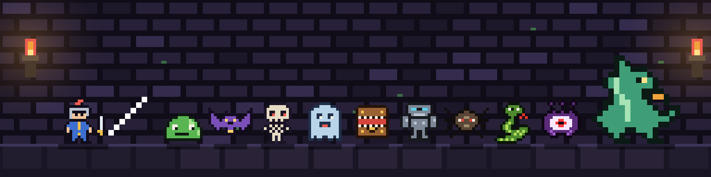
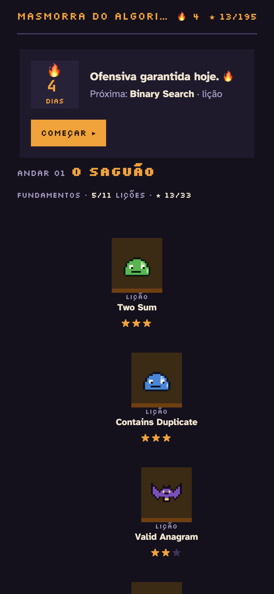
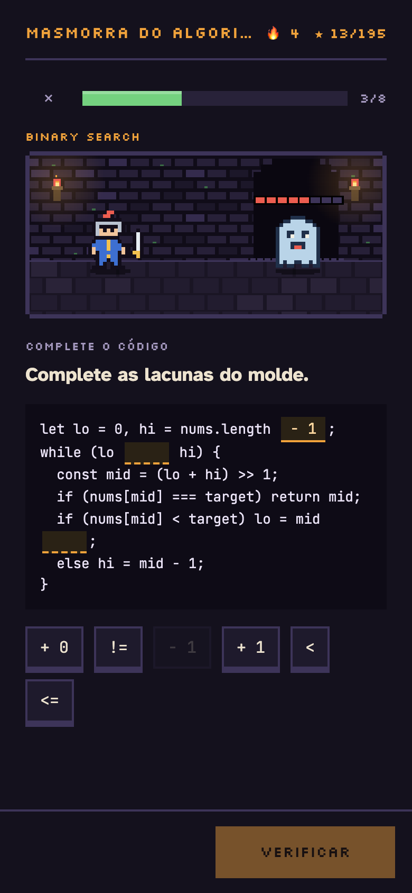
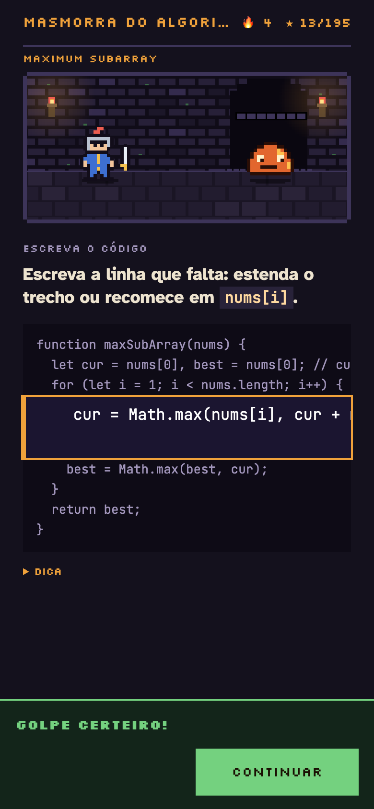
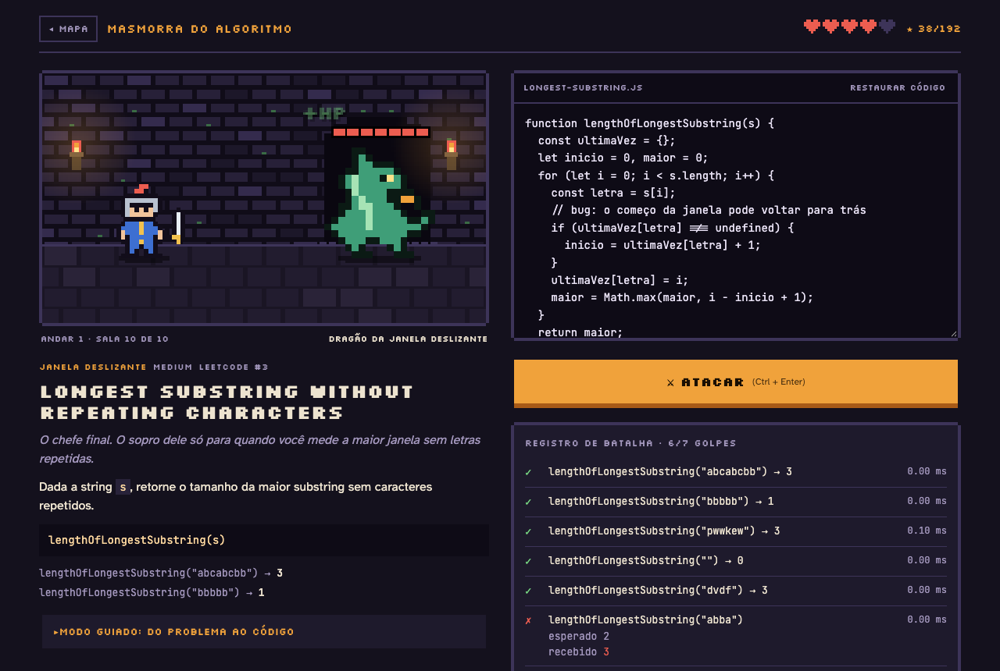
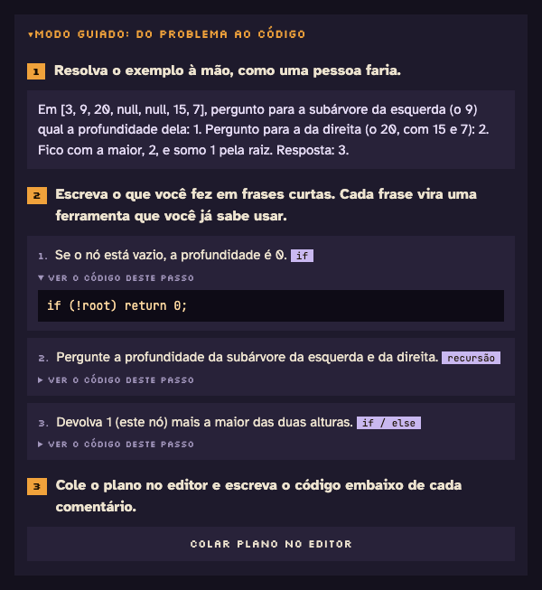
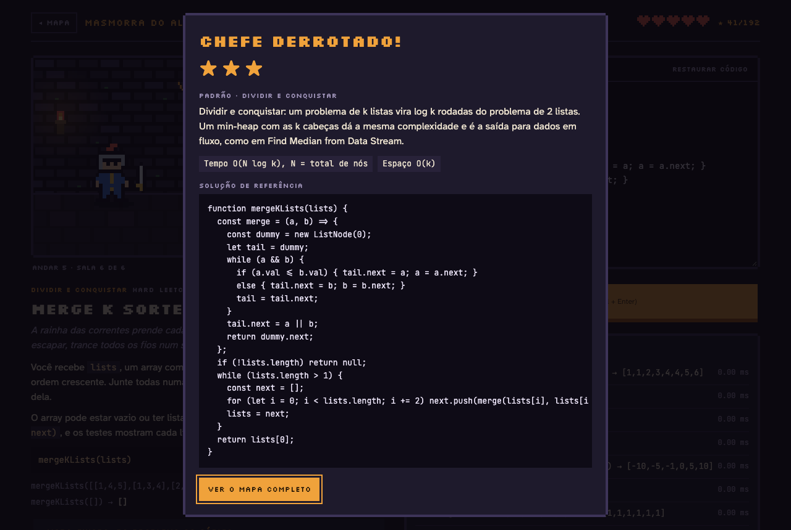

<p align="center">
  
</p>

<h1 align="center">Masmorra do Algoritmo</h1>

<p align="center">
  <b>Treine LeetCode em lições de 5 minutos, estilo Duolingo, numa masmorra em pixel art.</b><br>
  Uma lição por dia, a ofensiva 🔥 crescendo, e no fim de cada andar um chefe: o problema completo.
</p>

<p align="center">
  <a href="https://eduardonk9999.github.io/leetcode-dungeon/"></a>
  
  
  
</p>

<p align="center">
  🟢 15 Easy &nbsp;·&nbsp; 🟡 44 Medium &nbsp;·&nbsp; 🔴 5 Hard
</p>

---

## 🔥 Uma lição por dia

<table>
<tr>
<td width="33%"></td>
<td width="33%"></td>
<td width="33%"></td>
</tr>
</table>

Cada sala da masmorra virou uma **lição de uns 5 minutos**, com 7 ou 8 cards que levam da ideia ao código:

| Card | O que treina |
|---|---|
| 🧠 **Escolha** | a intuição: o que procurar, que estrutura usar, por que a força bruta não serve |
| 🧩 **Monte o plano** | colocar os passos da solução na ordem certa |
| ✏️ **Complete o código** | tocar nas fichas certas para preencher as lacunas |
| 🔮 **Qual a saída?** | rodar o algoritmo de cabeça, num caso que pega quem entendeu errado |
| 🐛 **Ache o bug** | o erro clássico que todo mundo comete nesse problema |
| ⌨️ **Escreva o código** | 1 a 3 linhas dentro da solução, rodando contra os testes de verdade |

Cada acerto é um golpe no monstro. Errou? O card volta no fim da lição até você acertar, como no Duolingo. Faça uma lição por dia para manter a **ofensiva 🔥**.

## ☁ Cada lição vira um commit no seu GitHub

Conecte o jogo a um repositório seu e **cada lição ou batalha vencida vira um commit**, no estilo do LeetHub:

```
leetcode-dungeon-progresso/
├── README.md                     ofensiva, estrelas e problemas resolvidos, atualizado sozinho
├── progresso.json                o progresso que sincroniza entre aparelhos
└── solucoes/andar-01/two-sum.js  o código que você escreveu, com link do problema e complexidade
```

```
✅ Two Sum (lição ★★★) · 🔥 4
```

- **O treino do dia aparece como quadradinho verde** no seu perfil.
- **O progresso sincroniza entre celular e computador:** ao abrir, o jogo baixa o que está no repositório e junta com o do aparelho, ficando com a melhor nota de cada sala e a ofensiva mais recente.
- **Sem internet?** As vitórias ficam numa fila e sobem juntas na próxima vez.

Para conectar, toque em **☁ Salvar no GitHub** no topo do jogo. Você vai precisar de um repositório público e de um [token fine-grained](https://github.com/settings/personal-access-tokens/new) com acesso **só a esse repositório** e permissão **Contents: Read and write**. O token fica só no seu navegador e só é enviado para `api.github.com`.

## ⚔ O chefe: o problema completo

<p align="center"></p>

No fim de cada andar, o chefe é o problema inteiro, como no LeetCode. Você também pode enfrentar o problema completo de qualquer sala ao terminar a lição.

1. **Escreva a função** no editor. `console.log` funciona.
2. **Ataque** (`Ctrl + Enter`). Cada teste que passa é um golpe no monstro. Se algum falhar, ele contra-ataca e você perde um ♥.
3. **Limpe a sala** e veja a solução de referência, a complexidade e a lição por trás do padrão.

| | |
|---|---|
| ★★★ | lição sem erros, ou batalha sem dicas e sem dano |
| 📜 Pergaminho | na batalha, mostra uma dica e custa 1 ★ |
| ⏱ Teste de resistência | entradas de 100 mil itens reprovam a solução O(n²) ou a recursão sem memória |
| 🔓 Andar 1 | é o treino: vencer o chefe dele abre todos os outros andares |

> **Em construção:** o Andar 1 já está todo em lições. Os andares 2 a 10 ainda são jogados como batalhas completas, sala por sala, enquanto as lições deles são escritas.

## 🧭 Modo guiado: do problema ao código

<table>
<tr>
<td width="48%"></td>
<td>

Travar na tela em branco é o problema de quase todo mundo que começa. Cada sala tem um caminho em três passos:

1. **Resolver o exemplo à mão**, como uma pessoa faria.
2. **Escrever o que você fez em frases curtas.** Cada frase vira uma ferramenta que você já conhece: `for`, `if`, objeto, recursão…
3. **Colar o plano no editor** como comentários e escrever o código embaixo de cada um.

O código de cada passo fica escondido até você pedir. Juntos, os passos formam a solução completa, e o validador garante que ela passa em todos os testes.

</td>
</tr>
</table>

## 🗺 Os andares

<p align="center"></p>

| Andar | Nome | Padrão | Salas | Chefe |
|:---:|---|---|:---:|---|
| 01 | **O Saguão** | Fundamentos | 10 | Dragão da Janela Deslizante · *Longest Substring Without Repeating Characters* |
| 02 | **A Biblioteca Proibida** | Arrays & Hashing | 5 | Basilisco da Sequência Eterna · *Longest Consecutive Sequence* |
| 03 | **As Minas Gêmeas** | Dois Ponteiros & Janela Deslizante | 5 | Olho Abissal da Fresta · *Minimum Window Substring* |
| 04 | **A Torre do Eco** | Pilha & Busca Binária | 5 | Colosso dos Mil Pilares · *Largest Rectangle in Histogram* |
| 05 | **As Correntes** | Linked List | 6 | Aracne, Tecelã das Correntes · *Merge k Sorted Lists* |
| 06 | **O Bosque Invertido** | Árvores | 8 | Dragão Espinho-Negro · *Binary Tree Maximum Path Sum* |
| 07 | **O Poço dos Ecos** | Heap & Backtracking | 6 | Dragão Soletrador do Abismo · *Word Search* |
| 08 | **As Cavernas Conectadas** | Grafos | 5 | Aranha-Rainha das Palavras · *Word Ladder* |
| 09 | **A Cripta da Memória** | Programação Dinâmica | 8 | Dracolich Reescritor · *Edit Distance* |
| 10 | **O Salão dos Intervalos** | Intervalos & Greedy | 6 | Titã do Último Portão · *Jump Game II* |

A lista completa com o link de cada problema:

<details>
<summary><b>Andar 01 · O Saguão</b> · Fundamentos</summary>

| # | Problema | Dificuldade | Padrão | Monstro |
|---:|---|---|---|---|
| [1](https://leetcode.com/problems/two-sum/) | Two Sum | 🟢 Easy | Hash Map | Slime Indexador |
| [217](https://leetcode.com/problems/contains-duplicate/) | Contains Duplicate | 🟢 Easy | Set | Gosma Repetida |
| [242](https://leetcode.com/problems/valid-anagram/) | Valid Anagram | 🟢 Easy | Contagem | Morcego Embaralhado |
| [125](https://leetcode.com/problems/valid-palindrome/) | Valid Palindrome | 🟢 Easy | Dois Ponteiros | Morcego Espelhado |
| [20](https://leetcode.com/problems/valid-parentheses/) | Valid Parentheses | 🟢 Easy | Pilha | Esqueleto Desbalanceado |
| [704](https://leetcode.com/problems/binary-search/) | Binary Search | 🟢 Easy | Busca Binária | Fantasma Bissetor |
| [121](https://leetcode.com/problems/best-time-to-buy-and-sell-stock/) | Best Time to Buy and Sell Stock | 🟢 Easy | Greedy | Esqueleto Mercador |
| [70](https://leetcode.com/problems/climbing-stairs/) | Climbing Stairs | 🟢 Easy | Prog. Dinâmica | Espectro da Escadaria |
| [53](https://leetcode.com/problems/maximum-subarray/) | Maximum Subarray | 🟡 Medium | Kadane | Magma de Kadane |
| [3](https://leetcode.com/problems/longest-substring-without-repeating-characters/) | **Longest Substring Without Repeating Characters 👑** | 🟡 Medium | Janela Deslizante | Dragão da Janela Deslizante |

</details>

<details>
<summary><b>Andar 02 · A Biblioteca Proibida</b> · Arrays & Hashing</summary>

| # | Problema | Dificuldade | Padrão | Monstro |
|---:|---|---|---|---|
| [49](https://leetcode.com/problems/group-anagrams/) | Group Anagrams | 🟡 Medium | Hash Map | Espectro dos Anagramas |
| [347](https://leetcode.com/problems/top-k-frequent-elements/) | Top K Frequent Elements | 🟡 Medium | Contagem | Mímico Colecionador |
| [238](https://leetcode.com/problems/product-of-array-except-self/) | Product of Array Except Self | 🟡 Medium | Prefixo & Sufixo | Golem Multiplicador |
| [36](https://leetcode.com/problems/valid-sudoku/) | Valid Sudoku | 🟡 Medium | Hash Set | Aranha das Nove Teias |
| [128](https://leetcode.com/problems/longest-consecutive-sequence/) | **Longest Consecutive Sequence 👑** | 🟡 Medium | Hash Set | Basilisco da Sequência Eterna |

</details>

<details>
<summary><b>Andar 03 · As Minas Gêmeas</b> · Dois Ponteiros & Janela Deslizante</summary>

| # | Problema | Dificuldade | Padrão | Monstro |
|---:|---|---|---|---|
| [167](https://leetcode.com/problems/two-sum-ii-input-array-is-sorted/) | Two Sum II - Input Array Is Sorted | 🟡 Medium | Dois Ponteiros | Morcego das Galerias |
| [15](https://leetcode.com/problems/3sum/) | 3Sum | 🟡 Medium | Dois Ponteiros | Trinca de Ossos |
| [11](https://leetcode.com/problems/container-with-most-water/) | Container With Most Water | 🟡 Medium | Dois Ponteiros | Slime da Cisterna |
| [424](https://leetcode.com/problems/longest-repeating-character-replacement/) | Longest Repeating Character Replacement | 🟡 Medium | Janela Deslizante | Espectro Falsário |
| [76](https://leetcode.com/problems/minimum-window-substring/) | **Minimum Window Substring 👑** | 🔴 Hard | Janela Deslizante | Olho Abissal da Fresta |

</details>

<details>
<summary><b>Andar 04 · A Torre do Eco</b> · Pilha & Busca Binária</summary>

| # | Problema | Dificuldade | Padrão | Monstro |
|---:|---|---|---|---|
| [150](https://leetcode.com/problems/evaluate-reverse-polish-notation/) | Evaluate Reverse Polish Notation | 🟡 Medium | Pilha | Mímico Pós-Fixo |
| [739](https://leetcode.com/problems/daily-temperatures/) | Daily Temperatures | 🟡 Medium | Pilha Monotônica | Morcego da Geada |
| [153](https://leetcode.com/problems/find-minimum-in-rotated-sorted-array/) | Find Minimum in Rotated Sorted Array | 🟡 Medium | Busca Binária | Ouroboros Girado |
| [33](https://leetcode.com/problems/search-in-rotated-sorted-array/) | Search in Rotated Sorted Array | 🟡 Medium | Busca Binária | Olho do Giro |
| [84](https://leetcode.com/problems/largest-rectangle-in-histogram/) | **Largest Rectangle in Histogram 👑** | 🔴 Hard | Pilha Monotônica | Colosso dos Mil Pilares |

</details>

<details>
<summary><b>Andar 05 · As Correntes</b> · Linked List</summary>

| # | Problema | Dificuldade | Padrão | Monstro |
|---:|---|---|---|---|
| [206](https://leetcode.com/problems/reverse-linked-list/) | Reverse Linked List | 🟢 Easy | Ponteiros | Gosma Contramão |
| [21](https://leetcode.com/problems/merge-two-sorted-lists/) | Merge Two Sorted Lists | 🟢 Easy | Ponteiros | Morcego Costureiro |
| [141](https://leetcode.com/problems/linked-list-cycle/) | Linked List Cycle | 🟢 Easy | Lebre e Tartaruga | Espectro do Laço Eterno |
| [19](https://leetcode.com/problems/remove-nth-node-from-end-of-list/) | Remove Nth Node From End of List | 🟡 Medium | Dois Ponteiros | Esqueleto Contador |
| [2](https://leetcode.com/problems/add-two-numbers/) | Add Two Numbers | 🟡 Medium | Simulação | Mímico Somador |
| [23](https://leetcode.com/problems/merge-k-sorted-lists/) | **Merge k Sorted Lists 👑** | 🔴 Hard | Dividir e Conquistar | Aracne, Tecelã das Correntes |

</details>

<details>
<summary><b>Andar 06 · O Bosque Invertido</b> · Árvores</summary>

| # | Problema | Dificuldade | Padrão | Monstro |
|---:|---|---|---|---|
| [226](https://leetcode.com/problems/invert-binary-tree/) | Invert Binary Tree | 🟢 Easy | Recursão | Morcego Pendurado |
| [104](https://leetcode.com/problems/maximum-depth-of-binary-tree/) | Maximum Depth of Binary Tree | 🟢 Easy | Recursão | Aranha das Raízes |
| [100](https://leetcode.com/problems/same-tree/) | Same Tree | 🟢 Easy | Recursão | Espectro Gêmeo |
| [102](https://leetcode.com/problems/binary-tree-level-order-traversal/) | Binary Tree Level Order Traversal | 🟡 Medium | BFS | Olho da Copa |
| [98](https://leetcode.com/problems/validate-binary-search-tree/) | Validate Binary Search Tree | 🟡 Medium | Recursão | Golem de Casca |
| [235](https://leetcode.com/problems/lowest-common-ancestor-of-a-binary-search-tree/) | Lowest Common Ancestor of a Binary Search Tree | 🟡 Medium | BST | Serpente do Galho |
| [230](https://leetcode.com/problems/kth-smallest-element-in-a-bst/) | Kth Smallest Element in a BST | 🟡 Medium | Em Ordem | Mímico do Tronco Oco |
| [124](https://leetcode.com/problems/binary-tree-maximum-path-sum/) | **Binary Tree Maximum Path Sum 👑** | 🔴 Hard | Recursão | Dragão Espinho-Negro |

</details>

<details>
<summary><b>Andar 07 · O Poço dos Ecos</b> · Heap & Backtracking</summary>

| # | Problema | Dificuldade | Padrão | Monstro |
|---:|---|---|---|---|
| [215](https://leetcode.com/problems/kth-largest-element-in-an-array/) | Kth Largest Element in an Array | 🟡 Medium | Heap | Golem do Monte |
| [1046](https://leetcode.com/problems/last-stone-weight/) | Last Stone Weight | 🟢 Easy | Heap | Baú Triturador |
| [78](https://leetcode.com/problems/subsets/) | Subsets | 🟡 Medium | Backtracking | Morcego do Eco |
| [46](https://leetcode.com/problems/permutations/) | Permutations | 🟡 Medium | Backtracking | Espectro das Mil Ordens |
| [39](https://leetcode.com/problems/combination-sum/) | Combination Sum | 🟡 Medium | Backtracking | Aranha Somadora |
| [79](https://leetcode.com/problems/word-search/) | **Word Search 👑** | 🟡 Medium | Backtracking | Dragão Soletrador do Abismo |

</details>

<details>
<summary><b>Andar 08 · As Cavernas Conectadas</b> · Grafos</summary>

| # | Problema | Dificuldade | Padrão | Monstro |
|---:|---|---|---|---|
| [200](https://leetcode.com/problems/number-of-islands/) | Number of Islands | 🟡 Medium | DFS | Gosma Arquipélago |
| [695](https://leetcode.com/problems/max-area-of-island/) | Max Area of Island | 🟡 Medium | DFS | Olho do Cartógrafo |
| [994](https://leetcode.com/problems/rotting-oranges/) | Rotting Oranges | 🟡 Medium | BFS | Esqueleto do Pomar Podre |
| [207](https://leetcode.com/problems/course-schedule/) | Course Schedule | 🟡 Medium | Ordenação Topológica | Ouroboros da Grade Curricular |
| [127](https://leetcode.com/problems/word-ladder/) | **Word Ladder 👑** | 🔴 Hard | BFS | Aranha-Rainha das Palavras |

</details>

<details>
<summary><b>Andar 09 · A Cripta da Memória</b> · Programação Dinâmica</summary>

| # | Problema | Dificuldade | Padrão | Monstro |
|---:|---|---|---|---|
| [198](https://leetcode.com/problems/house-robber/) | House Robber | 🟡 Medium | Prog. Dinâmica | Esqueleto Saqueador |
| [213](https://leetcode.com/problems/house-robber-ii/) | House Robber II | 🟡 Medium | Prog. Dinâmica | Espectro do Círculo |
| [322](https://leetcode.com/problems/coin-change/) | Coin Change | 🟡 Medium | Prog. Dinâmica | Mímico do Troco |
| [300](https://leetcode.com/problems/longest-increasing-subsequence/) | Longest Increasing Subsequence | 🟡 Medium | Prog. Dinâmica | Serpente Ascendente |
| [62](https://leetcode.com/problems/unique-paths/) | Unique Paths | 🟡 Medium | Prog. Dinâmica 2D | Aranha das Lajes |
| [139](https://leetcode.com/problems/word-break/) | Word Break | 🟡 Medium | Prog. Dinâmica | Olho do Grimório |
| [1143](https://leetcode.com/problems/longest-common-subsequence/) | Longest Common Subsequence | 🟡 Medium | Prog. Dinâmica 2D | Golem das Duas Lápides |
| [72](https://leetcode.com/problems/edit-distance/) | **Edit Distance 👑** | 🟡 Medium | Prog. Dinâmica 2D | Dracolich Reescritor |

</details>

<details>
<summary><b>Andar 10 · O Salão dos Intervalos</b> · Intervalos & Greedy</summary>

| # | Problema | Dificuldade | Padrão | Monstro |
|---:|---|---|---|---|
| [55](https://leetcode.com/problems/jump-game/) | Jump Game | 🟡 Medium | Greedy | Slime Saltitante |
| [56](https://leetcode.com/problems/merge-intervals/) | Merge Intervals | 🟡 Medium | Intervalos | Aranha Costureira |
| [57](https://leetcode.com/problems/insert-interval/) | Insert Interval | 🟡 Medium | Intervalos | Serpente Intrusa |
| [435](https://leetcode.com/problems/non-overlapping-intervals/) | Non-overlapping Intervals | 🟡 Medium | Greedy | Esqueleto Ceifador |
| [134](https://leetcode.com/problems/gas-station/) | Gas Station | 🟡 Medium | Greedy | Espectro das Lamparinas |
| [45](https://leetcode.com/problems/jump-game-ii/) | **Jump Game II 👑** | 🟡 Medium | Greedy | Titã do Último Portão |

</details>

## 👑 Derrube o chefe

<p align="center"></p>

Toda vitória abre o grimório: a lição do padrão, onde mais ele aparece em entrevista, a complexidade de tempo e espaço e uma solução de referência para comparar com a sua.

## 🛠 Rodar localmente

Não tem build nem `npm install`. Basta um servidor estático:

```bash
git clone https://github.com/eduardonk9999/leetcode-dungeon.git
cd leetcode-dungeon
python3 -m http.server 8000
```

Depois abra `http://localhost:8000`. O progresso e o código de cada sala ficam salvos no `localStorage` do navegador.

## 🧱 Por dentro

```
index.html         motor do jogo: combate, editor, cena em canvas e sprites
js/licao.js        trilha, lições de 5 minutos, cards e ofensiva
js/sync.js         salvar no GitHub: commits das vitórias e sincronização entre aparelhos
js/runtime.js      ListNode/TreeNode, conversão dos testes e comparação das respostas
levels/            um arquivo por andar (salas, testes, soluções) + guia de autoria
lessons/           as lições de cada andar + guia de autoria dos cards
tools/check.mjs    validador: roda soluções, modo guiado e os cards contra os testes
tools/banner.mjs   gera o banner deste README com os sprites do jogo
```

- **Seu código roda isolado** num Web Worker com 2,5 s de limite. Laço infinito não trava a página, só faz o monstro te acertar.
- **Listas e árvores** aparecem nos testes como arrays, no formato do LeetCode (árvore em ordem por nível, com `null`). `ListNode(val, next)` e `TreeNode(val, left, right)` já existem no editor.
- **Sprites são texto:** cada monstro é uma matriz 16×16 de letras, e cada sala troca só a paleta.
- **As respostas são flexíveis** quando a ordem não importa (Subsets, 3Sum, Group Anagrams…).

## 🧪 Criar salas e lições

O formato de uma sala (enunciado, testes, dicas, solução, modo guiado, monstro e paleta) está em [`levels/README.md`](levels/README.md), e o dos cards de uma lição em [`lessons/README.md`](lessons/README.md). Depois de editar, rode o validador (Node 18+):

```bash
node tools/check.mjs
```

Ele roda a solução de referência e o código montado do modo guiado contra todos os testes, usando o mesmo runtime do jogo, e reprova a sala se o código inicial vazio passar. Ele também confere cada card das lições: roda a solução de verdade para checar a resposta dos cards de saída e exige que o card de código passe nos testes com a resposta e falhe vazio. Hoje: **64 salas, 10 lições e 73 cards · 0 erros**.

---

<p align="center">
  <sub>Os problemas pertencem ao <a href="https://leetcode.com">LeetCode</a>; os enunciados aqui foram reescritos em português. Fontes: Silkscreen, Atkinson Hyperlegible e JetBrains Mono.</sub>
</p>
